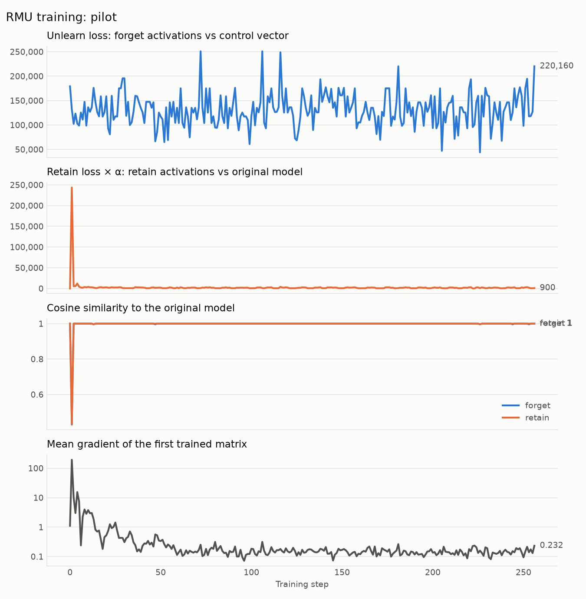
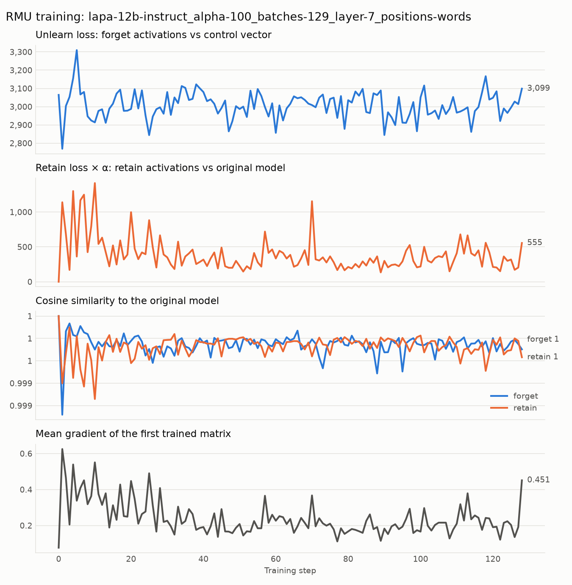
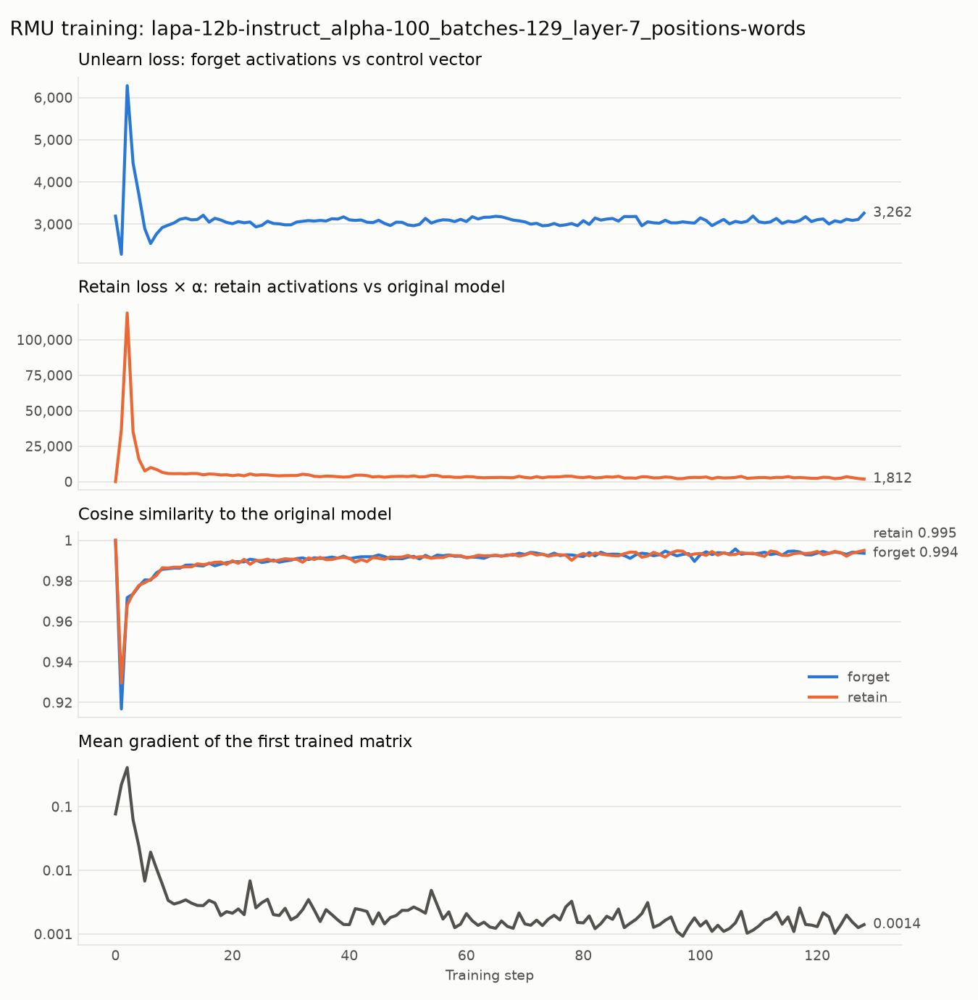
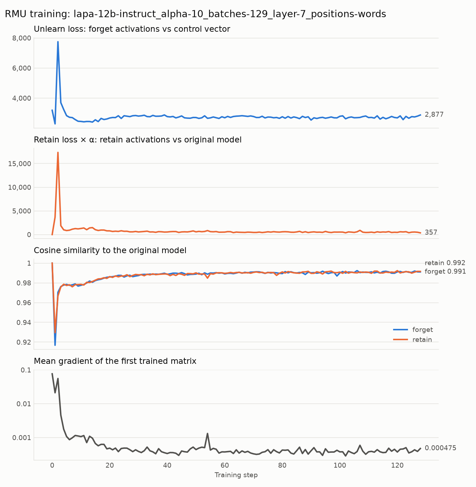

# Pilot report: RMU unlearning of gender stereotypes in Lapa 12B

*2026-10-11 · JUPITER (project `e-dev-2026d09-075`) · fairforget-unlearning*

## 1. Goal

Test whether **RMU** (Representation Misdirection for Unlearning, Li et al. 2024, code adapted from
[WMDP](https://github.com/centerforaisafety/wmdp)) can make an LLM "forget" gender stereotypes,
before evaluating the edited model on BBQ.

This pilot covers the **unlearning step only**. The BBQ before/after evaluation is not implemented
yet, so the results below are about training dynamics, not bias scores.

## 2. Setup

| | |
|---|---|
| Model | `lapa-v0.1.2-instruct` (Gemma 3 architecture, 48 layers, hidden size $H = 3840$), bf16, 22.7 GB per copy |
| Hardware | 1 node, 1 × GH200 (96 GB) per job; model load 15 s |
| Data | StereoSet intrasentence (test + dev), `bias_type = gender`: 1026 items |
| Forget set | stereotype sentences ("A woman is good with children.") |
| Retain set | anti-stereotype sentences ("A woman is good with games.") |
| `--no-split` | all 1026 items in both sets → 257 batches of 4 |
| `--split` | first half of items → forget, second half → retain → 129 batches of 4 |
| RMU edit | hooked layer $\ell = 7$; trained `mlp.down_proj.weight` in layers 5, 6, 7 (3 matrices of $3840 \times 15360$); AdamW; 1 epoch |

**RMU objective.** With $a_{b,t}$ the layer-7 activation of the edited model for sentence $b$,
token $t$, and $a^{\text{frozen}}_{b,t}$ the original model's:

$$
L = \underbrace{\operatorname{MSE}\bigl(a^{\text{forget}},\, c\bigr)}_{\text{unlearn: push to noise}}
\;+\; \alpha \cdot \underbrace{\operatorname{MSE}\bigl(a^{\text{retain}},\, a^{\text{frozen, retain}}\bigr)}_{\text{retain: keep as original}},
\qquad c = s \cdot \frac{u}{\lVert u \rVert},\; u \sim \mathcal{U}[0,1)^H
$$

where $s$ is the steering coefficient (`--steering_coeffs`, $\lVert c \rVert = s$). WMDP defaults:
$s = 20$, $\alpha = 100$, lr $= 5 \cdot 10^{-5}$.

**What success looks like during training:** the unlearn loss falls, the cosine similarity
between edited and original activations drops on the forget set but stays near 1 on the retain
set.

## 3. Runs

All runs: `lapa-12b-instruct`, layer 7, layers 5–7 `down_proj`, batch size 4, `--verbose`.
Plots are in this folder (`<run>_<split>_<positions>_steer<s>_lr<lr>_a<α>.png`).

| # | Job | Split | Loss positions | $s$ | lr | $\alpha$ | Steps | Outcome |
|---|---|---|---|---|---|---|---|---|
| 1 | 2274503 | no | all | 20 | 5e-5 | 100 | 257 | Flat; loss tracks batch length |
| 2 | | no | words | 20 | 5e-5 | 100 | 257 | Flat at "nothing changed" level |
| 3 | | yes | words | 7000 | 5e-5 | 100 | 129 | Flat at "nothing changed" level |
| 4 | | yes | words | 2500 | 5e-5 | 100 | 129 | Flat at "nothing changed" level |
| 5 | | no | words | 2500 | 5e-2 | 100 | 257 | Model moves, returns to original; forget = retain |
| 6 | 2280022 | yes | words | 2500 | 5e-2 | 100 | 129 | Same as 5 |
| 7 | 2280377 | yes | words | 2500 | 5e-2 | 10 | 129 | Same as 5, slightly more change |

*Job IDs of runs 2–5: see `usage_log.tsv`.*

## 4. Findings

### 4.1 The start-of-text token dominated the loss (run 1)

With the original loss, the unlearn loss had **no trend** over training (correlation with the
step: 0.05; mean of the first 50 steps ≈ 132k, last 50 ≈ 134k).

Instead, it depended on the **length of the batch**. The MSE averages over every position,
padding and BOS included. If one position per sentence has a much larger distance $D$ than all
others:

$$
L_{\text{unlearn}} = \frac{1}{BTH} \sum_{b,t} \lVert a_{b,t} - c \rVert^2
\;\approx\; \frac{B \cdot D}{BTH} = \frac{D}{TH}
\quad\Longrightarrow\quad L_{\text{unlearn}} \propto \frac{1}{T}.
$$

The data matches this prediction:

- $\operatorname{corr}(L, 1/\text{max words}) = 0.93$; the spread of $L$ is 25%, of $L \cdot T$ only ≈ 8%.
- Mean loss by longest sentence (words): 7 → 175k, 9 → 151k, 11 → 128k, 13 → 113k, 15 → 99k.
- Only 69 distinct loss values in 257 steps (bf16 rounding of the same $D/TH$).

That position is the **BOS token**, which LLMs use as an "attention sink" with massive
activations. Because pads are masked, BOS attends only to itself and is identical in every
sentence. **Measured directly in run 2:** word tokens have norm ≈ 2,400 (±2%), BOS ≈ 65,000,
i.e. BOS counts $\approx 27^2 \approx 700\times$ as much as a word token in the MSE. Nearly all
of the unlearn gradient therefore went into changing BOS, which the retain term (BOS is also in
every retain sentence) immediately pushed back.

**Fix:** `--loss_positions words` averages both losses over real word tokens only (padding,
BOS and EOS masked out); losses and cosines are computed in float32 (in bf16, a cosine near 1
can only be 1.0 or 0.996).

### 4.2 With the default learning rate, nothing moves (runs 2–4)

With BOS masked, the loss no longer depends on batch length, but it stays exactly at the level
expected if the activations **did not change at all**:

$$
L_{\text{unchanged}} \approx \frac{\lVert a \rVert^2 + \lVert c \rVert^2}{H}
$$

| $s$ | Predicted if unchanged | Observed |
|---|---|---|
| 20 | ≈ 1,500 | ≈ 1,500 |
| 2500 | ≈ 3,130 | ≈ 3,000 |
| 7000 | ≈ 14,260 | ≈ 14,100 |

Cosines stay above 0.999. Raising $s$ to the scale of the word activations (2500, 7000) did not
help: AdamW normalises gradients, so each weight moves by ≈ lr per step **regardless of the loss
scale**. The retain-loss and gradient curves of runs 3 and 4 are almost identical. Over 129
steps at lr 5e-5, a weight can move by at most ≈ 0.006; bf16 rounding may additionally discard
updates this small.

### 4.3 With a large learning rate, the edit is not selective (runs 5–7)

At lr 5e-2 the model does move: in the first steps both cosines drop to ≈ 0.92 and the retain
loss spikes. But then the retain term pulls the model back to almost the original (cosines
0.991–0.997, gradient → 0.001), and **the forget and retain curves are identical throughout**.
The edit changes stereotype and anti-stereotype sentences in exactly the same way.

- Using different items for forget and retain (`--split`, run 6) did not separate them. With
  `--no-split`, forget and retain batch $i$ are the same 4 items, and 61% of each forget
  sentence's words come before the one differing word (identical activations), but removing
  this did not change the picture.
- Lowering $\alpha$ to 10 (run 7) let the model change slightly more (unlearn loss ≈ 8% below the
  "unchanged" level), still identically for both sets.

**Interpretation.** RMU was designed for topic-level forgetting: WMDP forgets a whole domain
(e.g. biosecurity texts) while retaining Wikipedia, which the model represents very differently.
Stereotype and anti-stereotype StereoSet sentences are short, everyday gender sentences that
differ in one association; at layer 7 most of their tokens look alike. Any weight change that
pushes forget activations to noise pushes retain activations the same way, and the retain term
cancels it.

## 5. Conclusions

1. In its original form, RMU on Lapa 12B with StereoSet does not unlearn anything: the loss is
   dominated by the BOS token's massive activation. This is fixed by masking special tokens.
2. The WMDP defaults ($s = 20$, lr 5e-5) don't transfer to Lapa: the word activations are
   ≈ 120× larger than $\lVert c \rVert$, and the default learning rate does not move the model.
3. Even when the model moves, the edit is not selective between stereotype and anti-stereotype
   sentences. This, not hyperparameters, is the main obstacle.

## 6. Next steps

- **Loss only where the sentences differ:** unlearn from the first token at which the stereotype
  and anti-stereotype versions of an item diverge (the attribute word), where the stereotype
  information actually is.
- **Neutral retain text** (WMDP-style, e.g. Wikipedia) instead of anti-stereotypes, so the retain
  term protects general language rather than competing with the forget term.
- **Adaptive RMU:** scale $\lVert c \rVert$ to the activation norm of the word tokens (not one
  inflated by BOS), so the target scale carries over between models and layers.
- **Training in float32** for the trained matrices, to rule out bf16 rounding of small updates.
- **BBQ evaluation** of the original and edited models, needed before any claim about bias.
- Later: other layers or several layers at once (needs a per-layer scale).

## 7. Infrastructure and technical problems

The JUPITER setup (`slurm/`, `make env/smoke/submit/watch/jobs`) is now in the repo. Issues met
along the way, for the grant usage report:

| Problem | Fix |
|---|---|
| Old handbook started Jupyter on the login node (no GPU) | GPU work only through `sbatch`/`srun`; `make jupyter` starts it on a compute node |
| `module load PyTorch/2.9.1` gave no `python` | Load `Stages/2026 GCCcore/.14.3.0 PyTorch/2.9.1` |
| No `transformers`/`accelerate` modules | Per-person venv on top of the modules (`--system-site-packages`) |
| Module packages on `PYTHONPATH` shadowed newer venv packages (`regex` too old for transformers) | Venv put first on `PYTHONPATH` in `slurm/env.sh` |
| No `git` on compute nodes (first smoke job failed, exit 127) | Commit recording removed from jobs |
| Home quota nearly full (20 GB / 80k files) | pip / Hugging Face / triton caches moved to scratch |
| Shared model files live in Hugging Face snapshot subfolders | Short names in `config/default.yaml` point to `<model>/<hash>/` |
| Lapa (Gemma 3) layer layout differs from Llama: layers under `language_model`, `down_proj` is parameter 8 not 6, `hidden_size` in `text_config` | Layers and parameters looked up by name |
| `device_map="auto"` needs `accelerate` (missing dependency) | Added |

**Compute used:** one node per job (billed as a whole node: 288 cores, 4 GPUs). Runtimes and
node-hours of every job are in `fairforget-bias-mitigation/usage_log.tsv`.
